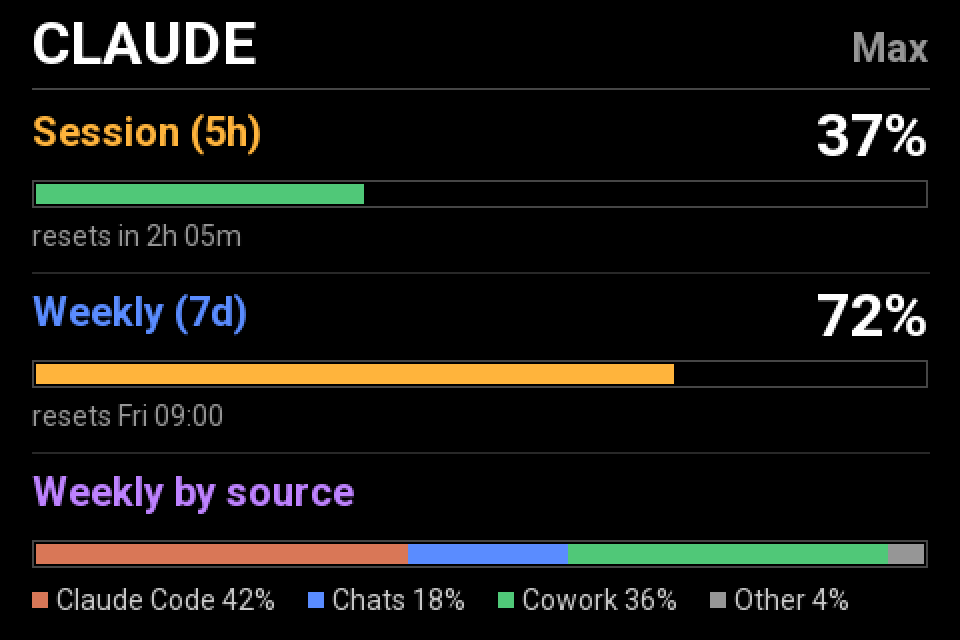

# Claude usage display (ESPHome)

A single-screen ESP32 display of your Claude.ai subscription usage: the 5-hour
session, the 7-day weekly limit, and a breakdown of the week by source
(Claude Code, Chats, Cowork, ...), each with a coloured bar and reset time.

It talks to Anthropic directly from the ESP32. No Home Assistant integration
and no server are needed. It is a custom ESPHome external component
(`external_components/claude_usage`) plus an example config.

> **Unofficial.** Not affiliated with or endorsed by Anthropic. It uses an
> undocumented usage endpoint and the public OAuth client that Claude Code
> uses, so it may break or be restricted at any time. Use it on your own
> account at your own risk.

*Layout mock-up with invented numbers, not a photo. `tools/screenshots/render.py`
redraws the display lambda with Pillow (Roboto if available); keep it in sync
with the YAML.*

## Hardware

Written for the DustinWatts ESP32_TFT_Combiner board (ILI9488, 480x320
landscape). The pin mapping is in `claude-usage-display.yaml`; adapt the
`spi`, `display`, `output` and `touchscreen` sections for other boards.

## Setup

1. Copy `secrets.yaml.example` to `secrets.yaml` and fill it in.
2. Set `time.timezone` in the YAML (it drives the reset clock times).
3. Flash: `esphome run claude-usage-display.yaml`
4. The screen shows "Sign-in needed" and the device IP. Open `http://<ip>/`,
   copy the **Claude Auth URL** into a browser, approve, then paste the code
   Anthropic shows into **Claude Auth Code**.

The refresh token is kept in flash and rotated automatically. If refreshes fail
three times in a row, the sign-in prompt reappears; paste a fresh code to
recover. The **Claude Sign Out** button forgets the login.

## How it works

PKCE OAuth sign-in, then a poll of the usage endpoint every 5 minutes (backing
off for 30 minutes on HTTP 429). Polling waits for Wi-Fi and a synced clock.
The raw usage payload is logged at debug level, so if your account's response
differs, the log shows what to adapt.

## Security notes

- The device's web page has no password by default, so anyone on your network
  can paste a code or sign it out. Add `auth:` under `web_server:` to protect it.
- The API and OTA use no encryption key or password in the example config.

## Licence

Apache-2.0. See `LICENSE`.
